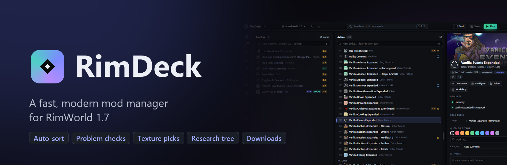

<p align="center">
  
</p>

<p align="center">
  <a href="https://github.com/Sandiozo/RimDeck/releases/latest"></a>
  <a href="https://github.com/Sandiozo/RimDeck/releases"></a>
  
  
  <a href="LICENSE"></a>
</p>

**RimDeck** loads a 350-mod list in about a quarter of a second, sorts it with explanations, catches problems before you launch, and shows what your mods actually do to textures, research and items.

## Download

Grab **`RimDeck-Setup-x.y.z.exe`** from the [latest release](https://github.com/Sandiozo/RimDeck/releases/latest) and run it. RimDeck finds RimWorld through Steam (or your RimSort settings) on first start, and **updates itself** when a new version is released.

> The installer isn't code-signed yet, so Windows SmartScreen may warn you: click **More info → Run anyway**.

## Screenshots

| | |
|---|---|
|  |  |
| **Mods** — drag and drop, live problem badges, details and settings | **Auto-sort** — every move explained before anything changes |
|  |  |
| **Texture conflicts** — compare versions and pick per texture | **Research tree** — tidy, by era or in game positions, problems flagged |
|  |  |
| **Items** — duplicates that several mods add | **Load time** — measured startup phases and the heaviest mods |

## What it does

- **Load order** — drag and drop, multi-select, undo/redo, Ctrl+K search, filters like `is:error`, `is:outdated`, `v:1.6`, `is:new`.
- **Auto-sort** — About.xml rules, dependencies, RimSort's community rules and rules inferred from XML overrides, with the reason for every move.
- **Problem checks** — missing dependencies, broken load-order rules, incompatibilities, duplicates, outdated mods with updated replacements.
- **Texture conflicts** — see which mod's texture wins, compare side by side, with a slider or as a pixel diff (DDS too), and pick single textures.
- **Research tree & items** — every mod's research on one zoomable tree, and items that exist more than once.
- **Mod settings** — edit any mod's saved settings without starting the game.
- **Game log** — groups errors and names the mods most likely responsible.
- **Workshop** — download mods and whole collections through SteamCMD (optional Steam login), with update checks.
- **Saves, lists & installs** — see which mods a save used, keep named lists, switch between several RimWorld installs.
- **Find a broken mod** — a binary search that halves the suspects on each launch.

RimDeck only writes `ModsConfig.xml` (backing it up first) and the settings files you edit. Mod DLLs are read, never run. The full feature reference is in [docs/FEATURES.md](docs/FEATURES.md).

## Build from source

```bash
npm install
npm run dev        # run with hot reload
npm run dist       # build the installer into release/
```

## License

[MIT](LICENSE) © Sandis (Sandiozo)
