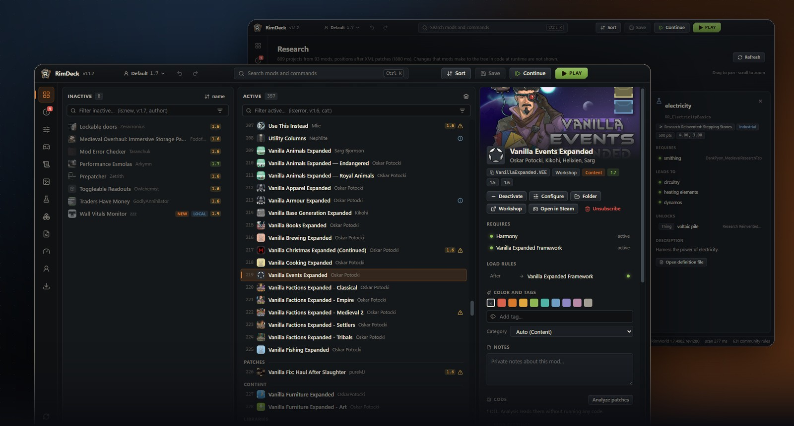
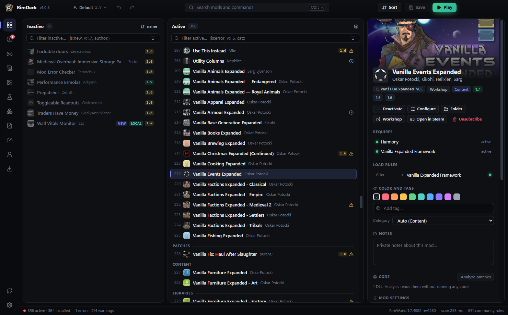
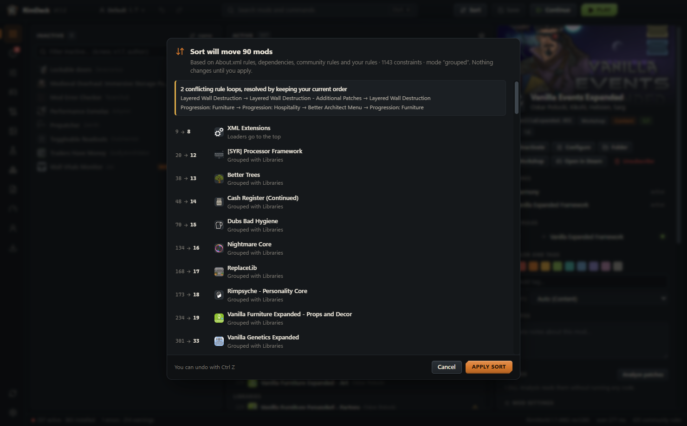
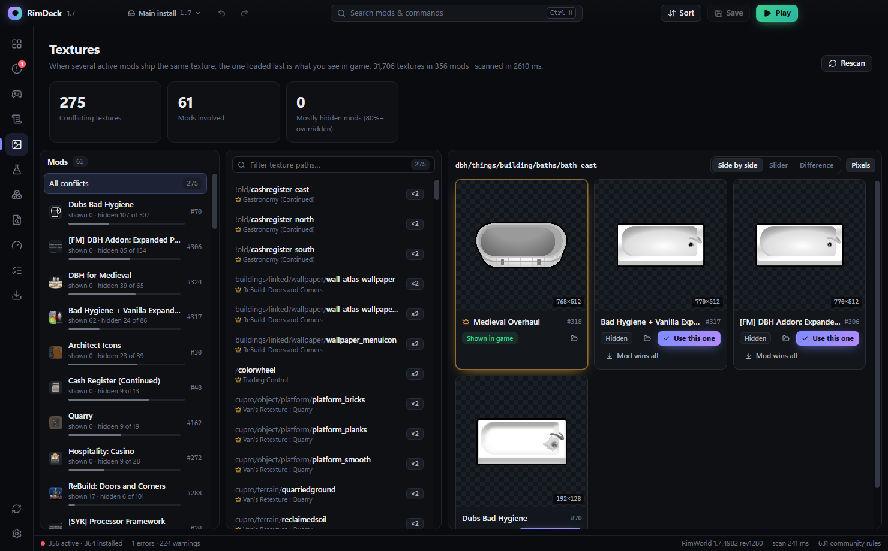
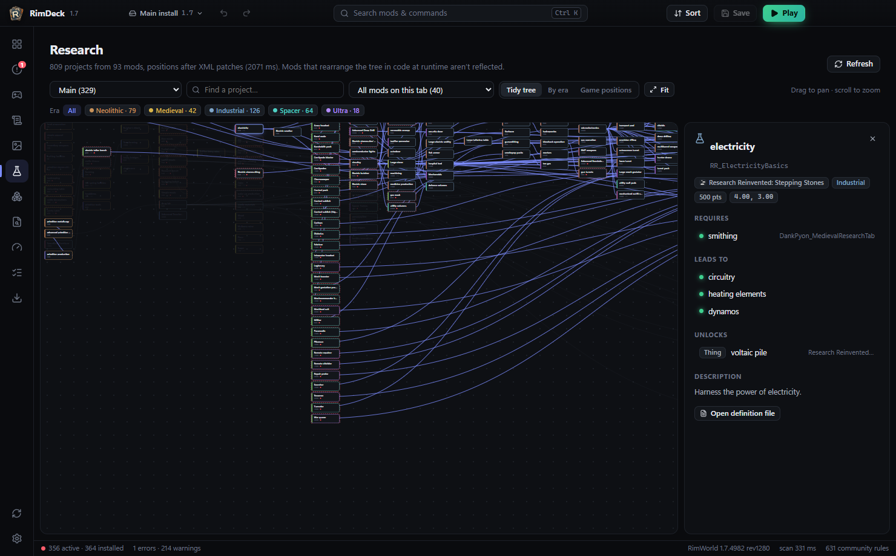
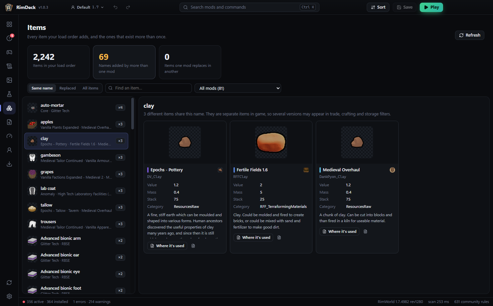
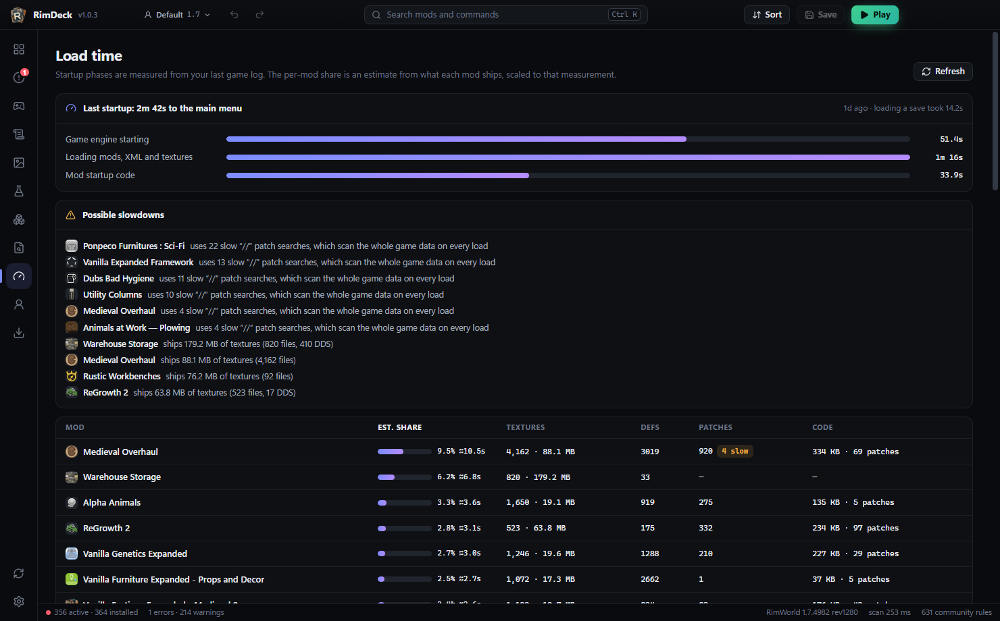

<div align="center">


### A fast RimWorld mod manager and load order sorter

Auto-sort with explanations · live problem checks · texture and research analysis · mod settings without the game · one-click Workshop downloads

<sub>Free and open source · a modern alternative to RimSort and RimPy · RimWorld 1.4 to 1.7 · Windows</sub>

<br>

<a href="https://github.com/Sandiozo/RimDeck/releases/latest"></a>

<br>

<a href="https://github.com/Sandiozo/RimDeck/releases/latest"></a>
<a href="https://github.com/Sandiozo/RimDeck/releases"></a>


<a href="LICENSE"></a>

<sub><a href="#install">Install</a> &nbsp;•&nbsp; <a href="#screenshots">Screenshots</a> &nbsp;•&nbsp; <a href="#what-it-does">Features</a> &nbsp;•&nbsp; <a href="docs/FEATURES.md">Full reference</a> &nbsp;•&nbsp; <a href="#build-from-source">Build</a> &nbsp;•&nbsp; <a href="https://github.com/Sandiozo/RimDeck/discussions">Discussions</a></sub>

<br><br>



</div>

<br>

| Fast | Explained sorting | Safe |
|:--|:--|:--|
| Scans 350+ mods in about a quarter of a second, without loading screens or refresh buttons. | Each auto-sort move shows the rule behind it. Nothing changes until you apply it. | RimDeck writes only `ModsConfig.xml` and the settings you edit, and backs them up first. Mod code is read, never run. |

## Install

1. Download **`RimDeck-Setup-x.y.z.exe`** from the [latest release](https://github.com/Sandiozo/RimDeck/releases/latest) and run it.
2. On first start, RimDeck finds RimWorld through Steam or imports your RimSort folders and rules.
3. RimDeck **updates itself** when a new version is released.

> [!NOTE]
> The installer is not code-signed yet, so Windows SmartScreen may show a warning. Select **More info → Run anyway**.

## Screenshots

| | |
|---|---|
|  |  |
| **Mods** — drag and drop, live problem badges, details and settings | **Auto-sort** — every move explained before anything changes |
|  |  |
| **Texture conflicts** — compare versions and pick per texture | **Research tree** — tidy, by era or in game positions, with problems flagged |
|  |  |
| **Items** — duplicate items added by several mods | **Load time** — measured startup phases and the heaviest mods |

## What it does

- **Load order** — drag and drop, multi-select, undo/redo, Ctrl+K search, filters like `is:error`, `is:outdated`, `v:1.6`, `is:new`.
- **Auto-sort** — About.xml rules, dependencies, RimSort's community rules and rules inferred from XML overrides, with the reason for every move.
- **Problem checks** — missing dependencies, broken load-order rules, incompatibilities, duplicates, outdated mods with updated replacements.
- **Texture conflicts** — see which mod's texture wins, compare side by side, with a slider or as a pixel diff (DDS too), and pick single textures.
- **Research tree and items** — every mod's research on one zoomable tree, and items that exist more than once.
- **Continue** — one click starts RimWorld straight into your latest save.
- **Mod settings** — its own page in the sidebar: edit any mod's settings without starting the game, including ones still at their defaults.
- **Game log** — groups errors and names the mods most likely responsible.
- **Workshop** — download mods and whole collections through SteamCMD (optional Steam login), with update checks.
- **Profiles** — separate setups, each with its own game install (game version) and its own mods and load order; switch from the title bar.
- **Saves** — see which mods a save used and load that list.
- **Find a broken mod** — a binary search that halves the suspects on each launch.

Full feature reference: [docs/FEATURES.md](docs/FEATURES.md).

## Build from source

```bash
npm install
npm run dev        # run with hot reload
npm run dist       # build the installer into release/
```

## Contributing

Bug reports, ideas and pull requests are welcome: see [CONTRIBUTING.md](CONTRIBUTING.md), or ask in [Discussions](https://github.com/Sandiozo/RimDeck/discussions). If RimDeck saves you time, a ⭐ helps other players find it.

## License

[MIT](LICENSE) © Sandis (Sandiozo)
