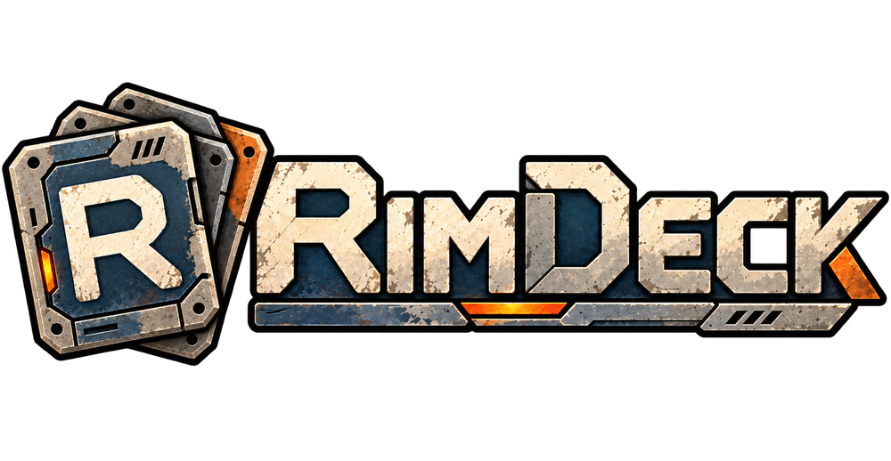

<p align="center"></p>

# Feature reference

A fast mod manager for RimWorld 1.7, with a dark, compact, keyboard-friendly interface.

## Getting started

- **Installer:** `RimDeck-Setup-<version>.exe` from [Releases](https://github.com/Sandiozo/RimDeck/releases) (start-menu and desktop shortcuts, uninstaller). The installer is unsigned, so SmartScreen may show a warning the first time. Installed copies update themselves from GitHub releases.
- **From source:** `npm install`, then `npm run dev`. On npm 11, run `node node_modules/electron/install.js` once if the Electron binary is missing.
- **Build the installer:** `npm run dist`. **Publish a release:** bump `version` in package.json, then `npm run release` (needs the GitHub CLI logged in to an account that can write to the repository). It builds once and uploads the installer, its blockmap and `latest.yml` together, which auto-update needs to match.
- **README screenshots:** `npm run screenshots` (saves to `docs/screenshots/`; skips screens that show local paths).

On first start RimDeck reads your paths from RimSort (or finds RimWorld through Steam), and imports RimSort's rules, ignored mods, colors and notes.

## What it does

| Area | Details |
|---|---|
| Scanning | Reads every `About.xml`, `loadFolders.xml`, `*ByVersion` rule and version folder for the running game version. ~250 ms for 360 mods. |
| Load order | Drag and drop between and within lists, multi-select (Ctrl/Shift), Alt+↑/↓ to move, double-click or Enter to toggle, undo/redo. Activating a mod also activates the mods it requires. |
| Auto-sort | Topological sort using About.xml rules, dependencies, RimSort's community rules database and your own rules. Three styles: group by category, keep my order, alphabetical. A **preview shows every move and why** before anything changes, and rule loops between mods are reported. |
| Live problems | Missing or inactive dependencies, broken load-order rules, incompatibilities, duplicates, mods not marked for your game version, mods listed but not installed. Each comes with one-click fixes. Hover a mod's warning icon for details. Updated replacements for outdated mods come from the *Use This Instead* database. |
| Harmony analysis | Reads mod DLLs without running them and lists every Harmony patch (prefix, postfix, transpiler, finalizer, manual). Shows which other active mods patch the same game methods. |
| Game log | Parses `Player.log` (including the 1.7 format), groups repeated errors by stack trace, and names the mods most likely responsible (from stack frames, Harmony patch info and mod namespaces). |
| Texture conflicts | Finds every texture path shipped by more than one active mod and shows which one the game uses (the last loaded). Per-mod "shown / hidden" counts flag mods that are mostly overridden. Compare side by side, with a slider, or as a pixel difference; **Use this one** picks a single texture: the texture is copied into a small local mod, *RimDeck Texture Picks*, which RimDeck keeps active and last, so you can mix textures from different mods. *Undo pick* deletes the copy; the original mods are never touched. **Mod wins all** moves the whole mod below the others instead. DDS textures are decoded for preview (BC1–BC7 and uncompressed). |
| Research tree | Every active mod's research projects on their tabs and positions (after XML patches, including Research Reinvented's coordinate patches), with prerequisite lines, pan and zoom, search, and per-mod filtering. Click a project for its mod, cost, prerequisites, what it leads to, what it unlocks, and which mods patched it. Flags overlapping nodes, missing prerequisites and loops. Layout changes that mods make in code at runtime are not shown. |
| Items | Every item your load order adds, with icons from the mods' textures. *Same name* groups different items that share a name (e.g. clay from three mods); *Replaced* lists items one mod redefines over another. "Where it's used" searches the mod files for the item. |
| XML analysis | Indexes every Defs and Patches file of your active mods (about 9,000 files, ~2 s the first time, cached after). Lists defs that two mods both define and values two mods both replace, and which one the game ends up using. When a mod overrides another mod's XML *and* refers to it (FindMod, MayRequire, or inherits its abstract defs), RimDeck infers "load after" and the sorter uses it, without overriding any explicit rule. |
| Search mod files | Full-text search across all Defs and Patches XML, plus "defined by / patched by" for any defName. Game-log errors that name a def link directly to a search. |
| Since you last played | Compares against the last launch from RimDeck, or the game log's start time if you launched elsewhere: updated, newly installed, removed, turned on and off. Links to each mod's Steam change notes; `is:changed` filters the lists. |
| Mod settings | A page in the sidebar lists every mod with settings (active mods first) and edits them without starting the game. RimWorld only saves settings that differ from their defaults, so RimDeck reads each mod's settings, types and defaults from its DLL (without running it) and shows them all, including mods whose settings were never changed, nested settings and settings saved through the mod's own helper methods. Labels, tooltips and slider limits come from the mod's own settings window, translated through its English language files. Lists and dictionaries can have entries added and removed; ranges, colours and choices get matching controls. Editing: switches for True/False, fields for numbers and text, and dictionaries shown as name → value. Refuses to save while RimWorld is running, and backs up the old file first. "Reset" moves the file aside so the game recreates defaults. Leftover settings from uninstalled mods can be moved to a backup folder. |
| Saves | Shows which mods each save used, what's missing (with Workshop links) and what differs. Can load a save's mod list, or **play with this save's mods** (switches, saves and starts the game; pick the save in the main menu, since RimWorld cannot be told which save to open). |
| Load time | Measures your last startup from the game log (engine start, loading mods/XML/textures, mod startup code, save loading) and estimates each mod's share from what it ships: textures, sounds, defs, patches (flags slow `//` patch searches), code and Harmony patches. |
| Appearance | Steel-and-rust dark theme, a parchment light theme, or System to follow Windows (Settings → Appearance and data). Seven accent colours. |
| Game installs | Manage several RimWorld copies (for example 1.6 next to 1.7) in Settings → Game installs: add, rename and remove them. Each install has its own folders, backups and play history. An install can use a separate data folder: RimDeck launches it with `-savedatafolder`, so its saves, mod settings and ModsConfig.xml stay separate. Workshop mods are shared. |
| Game version | Check mods against another version than the installed one (Settings → Game version), e.g. when planning a 1.6 list. |
| Updates | Settings → About: point RimDeck at the GitHub repository its releases are published to, and it checks for new versions at startup. |
| Find a broken mod | Binary search: disables half of the suspects at a time, keeping dependencies intact, until one mod is left. Then restores your list. |
| Workshop downloads | **Downloads & updates** panel. Paste Workshop links or ids, or click *Download* on a missing dependency, a listed-but-not-installed mod, a replacement suggestion, or a save's missing mods. SteamCMD (anonymous login, no Steam account needed) is installed on first use into `%APPDATA%/RimDeck/steamcmd`. Items download in batches of 20, timeouts are retried, and each item is moved into your local mods folder as soon as it finishes. |
| Update checks | Compares every Workshop-linked mod against the public `GetPublishedFileDetails` API (no key needed). The installed version comes from Steam's `appworkshop_294100.acf` for subscribed mods, RimDeck's own download record for mods it installed, or file dates as a last resort. Local copies update in place; for subscribed mods RimDeck points you to Steam, which owns that folder. |
| Collections & sharing | Paste a Workshop collection link (Downloads view, or *Import Workshop collection* in the palette). Nested collections are followed. Each mod shows as active, installed or missing; download the missing ones, or *Use as mod list* to make the collection the working load order (Core, your active DLCs and Harmony first, required mods pulled in, then the sort preview). After downloads finish, *Apply again* picks up the new mods. **Mod lists → Copy as text / Copy Workshop IDs** shares your active list. |
| Steam account (optional) | Downloads are anonymous by default. Under *Downloads → Steam account* you can log in for the few items that need an account owning RimWorld. RimDeck first tries SteamCMD's saved session and only asks for the password if there is none; the password goes to SteamCMD as a process argument and is never stored or logged. Only the account name and a logged-in flag are kept (`steamcmd/rimdeck-account.json`). SteamCMD ignores piped stdin on Windows and buffers its output, so RimDeck reads prompts live from `steamcmd/logs/console_log.txt`; when Steam Guard asks for a code, RimDeck ends that run, asks you for the code and logs in again with it. A "confirm in the Steam Mobile app" wait shows a message and a Cancel button. Anonymous failures that look like ownership problems get a *Log in* hint. |
| Profiles and backups | A profile combines a game install (and therefore a game version) with its own mods and load order. Switch profiles from the title bar or the Profiles view; switching writes the profile's mods to ModsConfig.xml. Saving the load order updates the active profile. Profiles can be created from the current load order, duplicated, renamed, or imported from XML (RimSort/RimPy/ModsConfig format) or a `.rws` save. ModsConfig.xml is backed up automatically before every save; the last 30 backups are kept. |
| Organizing | Colors, tags, notes and category overrides per mod. Filter syntax: `is:error`, `is:warning`, `is:outdated`, `is:local`, `is:workshop`, `cat:library`, `tag:x`, `author:x`, `has:dll`, `-negate`. Each list has its own filter. |
| Live updates | Watches the mod folders (Workshop downloads, manual installs) and ModsConfig.xml. If the game changes the config, RimDeck asks before reloading it. |
| Safety | Only ModsConfig.xml is written, atomically, after a backup. The newest save is backed up on every launch. Downloads only add folders to the local mods folder; when an update replaces a copy, the old one goes to the Recycle Bin (or `%APPDATA%/RimDeck/replaced-mods` if that fails) after you confirm, and RimDeck never writes into Steam's Workshop folder. |

Shortcuts: `Ctrl K` palette, `Ctrl S` save, `Ctrl Shift S` sort, `Ctrl Z / Y` undo/redo, `F5` save and play.

## File locations

- Settings, tags/notes, lists: `%APPDATA%/RimDeck/` (`settings.json`, `user.json`)
- ModsConfig backups: `%APPDATA%/RimDeck/backups/`
- Save backups: `%APPDATA%/RimDeck/save-backups/`
- Cached rule databases and thumbnails: `%APPDATA%/RimDeck/db`, `/thumbs`
- SteamCMD and its staging folder: `%APPDATA%/RimDeck/steamcmd/`; record of what RimDeck downloaded: `downloads.json`

### Why downloads are moved into the mods folder

RimWorld only loads mods from `Data/`, `Mods/` and Steam's Workshop folder. Leaving downloads in SteamCMD's content folder and scanning it as an extra root would show them in RimDeck but the game would never load them. So each finished item is moved from `steamcmd/steamapps/workshop/content/294100/<id>` into `<local mods>/<id>` (renamed when on the same drive, copied then removed from staging otherwise), and `About/PublishedFileId.txt` is added if missing so the copy stays linked to its Workshop page. RimSort instead points SteamCMD's content folder at the mods folder with a symlink; moving keeps SteamCMD from ever writing into your mods folder directly. Before each batch RimDeck deletes SteamCMD's own `appworkshop_294100.acf` (in its private folder), because SteamCMD otherwise skips items it thinks are already installed.

## Code layout

```
src/shared/     types, sort (Kahn + explanations), validate (live problems), graph (rules → edges)
src/main/core/  scanner, modsconfig, paths, rulesdb, saves, logs, harmony (ECMA-335 reader), rimsort import,
                steamcmd (install, batch runs, download queue), workshop (Steam Web API, ACF reader)
src/main/       service (API), index (Electron window, IPC, image protocol, dev HTTP bridge on :5199)
src/renderer/   React UI (zustand store, components, views)
```

In dev mode the main process also serves the API over HTTP on `127.0.0.1:5199`, so the UI can be opened in a normal browser at `http://localhost:5173`.

## Not yet implemented

PNG→DDS texture conversion, XML patch simulation (finding failing patches before launch), translations.
